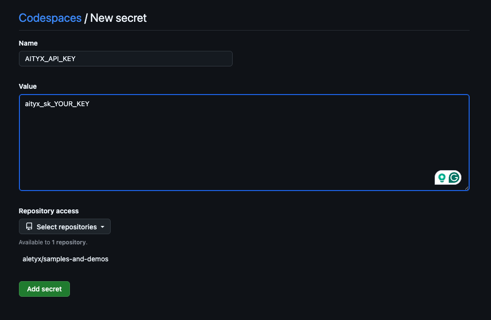

# Mortgage Hub

Mortgage Hub brings a home buyer's mortgage, from application to closing,
into one place. For now the app is a welcome page with a form to request
a mortgage proposal, and a regulatory check that says whether a lender can
process it under current US rules, run by [aityx.ai](https://aityx.ai).

## Technology

| Part | Technology |
|---|---|
| App ([mortgagehub_app/](mortgagehub_app)) | [Flutter](https://flutter.dev) (Dart): web, Android, iOS and Linux from one codebase. On the web it runs the regulatory check itself, calling [aityx](https://aityx.ai) from the browser with your key |
| Rules | An [aityx.ai](https://aityx.ai) decision model ([proposal-check.json](mortgagehub_app/assets/models/proposal-check.json)), an asset of the app, sent with every check |
| aityx from the browser | [packages/aityx_web](../packages/aityx_web), shared by the aityx demos: finds the key, calls aityx, draws the status light |
| Serving | The repository's [index](../Index/), which serves the app's release web build at `/mortgagehub/`, beside the other aityx demos, on one origin |
| Dev environment | [Devbox](https://www.jetify.com/devbox) (Nix) on a laptop, or a [Dev Container](https://containers.dev/) from the [published image](../image/) |

The toolchain is pinned in [devbox.json](devbox.json) and locked in
[devbox.lock](devbox.lock): Flutter, GNU Make and curl.

There is no API and no server of its own: the app is a static web build,
and the index serves it. The regulatory check posts the model and the
proposal's figures (never the borrower's name, email or phone) to aityx's
`/v1/systemone` from the browser.

## Your aityx key

The regulatory check runs on [aityx.ai](https://aityx.ai) and needs an API
key, always **yours**: none ships with this repository and none is built
into the app. Sign up at [aityx.ai](https://aityx.ai), create a key on
the **API keys** page of [console.aityx.ai](https://console.aityx.ai), then
open the index page (http://localhost:8800/, or port 8800 in a codespace),
paste it in **Your aityx key** and choose **Check and save**. Mortgage Hub
and every other demo on that address use it from then on: it stays in your
browser ("Remember on this device" or "Only this session"), and the app
sends it only to aityx.

Without a key of yours, the app uses the index server's **dev key**, when
it has one (`AITYX_API_KEY` in its environment or in the repository's
`.env`, see [../.env.example](../.env.example)), through the server's own
proxy, so that key never reaches the browser. Without either, the light at
the top right is red ("aityx: no key — set yours on the index page") and
the check says *aityx is not set up: set your key on the index page*.

## Run it locally

From the root of the repository, with
[Devbox](https://www.jetify.com/devbox/docs/installing_devbox/):

```bash
./start-aityx.sh MortgageHub   # or ./start-aityx.sh for every aityx demo
```

That builds the app's release web build if it's missing or out of date
([scripts/build.sh](scripts/build.sh): about 20 s on a laptop, a minute or
two on a 4-core codespace; up to date, a second) and starts the index,
which serves it at http://localhost:8800/mortgagehub/. Set your key on the
index page (above), then open the Mortgage Hub card. Stop it with
`./stop-aityx.sh`.

To build ahead without starting anything: `bash scripts/build.sh` (or
`devbox run build`) from this folder. To check the mortgage rules on
aityx after changing the model: `bash scripts/model-test.sh` (it reads the
key from the repository's `.env`; see [Regulatory
check](specs/regulatory-check.md#verified)). `bash scripts/aityx-check.sh`
runs the aityx docs' example with the same key.

### Building the binaries

The [Makefile](Makefile) builds release binaries through
[scripts/make.sh](scripts/make.sh):

```bash
make            # every platform this host can build
make web        # mortgagehub_app/build/web/ (no CDN)
make android    # mortgagehub_app/build/app/outputs/flutter-apk/app-release.apk
make ios        # mortgagehub_app/build/ios/iphoneos/Runner.app (macOS, unsigned)
make linux      # mortgagehub_app/build/linux/<arch>/release/bundle/ (Linux only)
make clean
```

Pass `MODE=profile` or `MODE=debug` for other build modes,
`WEB_BASE_HREF=/mortgagehub/` for a web build the index can serve, and
`IOS_CODESIGN=1` to sign the iOS build (this needs a signing team in Xcode).
The native builds open and fill the form, but their regulatory check says
aityx is not set up: they have no index page to set a key on (their key
store is in memory only) and no dev proxy.
The version is `X.Y.Z`: X and Y from [version.X.txt](version.X.txt) and
[version.Y.txt](version.Y.txt), Z the build time (see
[scripts/version.sh](scripts/version.sh)).
The artifact's group and artifact IDs, `aityx:mortgagehub`, are in
[group.id.txt](group.id.txt) and [artifact.id.txt](artifact.id.txt).

## Run it in a codespace

[](https://codespaces.new/aityx-labs/aityx-demos?devcontainer_path=.devcontainer%2Faityx%2Fdevcontainer.json&machine=standardLinux32gb)

That link opens this repository's **aityx demos** dev container on a
4-core machine (16 GB RAM). It starts the index, which serves Mortgage Hub
with the rest of its group (Contact Hub, Cellfie, PokerFace, RoboRules and
RiverRace). To choose for yourself instead, use *Code → Codespaces → New
with options* and pick **aityx demos** as the dev container
configuration; the other one, **datyx demos**, doesn't include Mortgage
Hub. Mortgage Hub's own dev container, the one the group's were copied
from, is kept in
[.devcontainer/archive/MortgageHub/](../.devcontainer/archive/MortgageHub).

When the index page opens (port **8800**, the only port), paste your key
in **Your aityx key** (see [Your aityx key](#your-aityx-key)), then open
the Mortgage Hub card, at `/mortgagehub/` on the same address. The
codespace copies the group's release web builds from the [published
image](../image/); a demo that changed since the image was made builds
itself, a minute or two, while the others are already up.

**Optional: a dev key for the codespace.** An `AITYX_API_KEY` Codespaces
secret (at
[github.com/settings/codespaces](https://github.com/settings/codespaces),
**New secret**, with access to `aityx-labs/aityx-demos`) is a dev key that
every visitor of your codespace uses unless they set their own. Add an
`AITYX_URL` secret only for a non-default endpoint.



The creation page then lists `AITYX_API_KEY` under *Recommended
secrets*; tick it as associated with the repository for it to reach the
codespace. The screenshot still shows the former **Mortgage Hub** dev
container:


**If the app doesn't start, send us `startup.log` from the root of the
repository.** Every step of the codespace's start goes there,
timestamped. It holds no secrets: a key and a token appear only as *set*
or *not set*.

**Check the port's visibility.** In the **Ports** panel, the *Visibility*
column for 8800 should say **Public**, so the link can be shared. If it
says **Private**, right-click the port, choose **Port Visibility →
Public** and reload. Each visitor sets their own key on the index page; a
dev key, if you set one, is used by every visitor who hasn't.

## Run it in a dev container locally

Open the repository root in VS Code and choose **Reopen in Container**,
then **aityx demos**. The dev containers live at the root of the
repository, in [.devcontainer/](../.devcontainer), because that is where
GitHub looks for them: one per demo group, Mortgage Hub's in
[.devcontainer/aityx/](../.devcontainer/aityx). It starts the index, which
serves this demo among the aityx group, on port 8800. Set your key on the
index page; for a dev key, put `AITYX_API_KEY` in the repository's `.env`.

## Contributing

1. Create a branch from an up-to-date `main`.
2. Make one change per pull request, with its tests. Run `flutter analyze`
   and `flutter test` in `mortgagehub_app/`, and `bash scripts/build.sh`.
3. Update the matching feature spec in [specs/](specs/) and add an entry to
   [specs/requests.md](specs/requests.md).
4. Open a pull request against `main`.

## Learn more

- [specs/](specs/README.md): the specification of every feature.
