# aityx demos

Working examples of business automation with [aityx.ai](https://aityx.ai):
decision models, and the apps and games built around them. Each folder is a
self-contained demo with its own README.

The demos come in three groups, each with its own index page, dev container
and codespace:

- **[aityx](#aityx)**: apps and games whose decisions run on aityx (port 8800).
- **[multyx](#multyx)**: multiplayer games with a Google sign-in and a
  leaderboard (port 9700).
- **[datyx](#datyx)**: data-intensive applications, with their databases,
  catalogue and streams (port 9800).

## Your aityx key

No key ships with this repository. To get one:

1. Sign up at [aityx.ai](https://aityx.ai).
2. In the [aityx console](https://console.aityx.ai), open **API keys** and
   copy a key.
3. Open the aityx index (http://localhost:8800/demos/ or your codespace),
   paste the key in **Your aityx key** and choose **Check and save**.

The key stays in your browser, and every aityx demo uses it. A demo opened
without a key asks for it itself, in a small form where it calls aityx (the
key, optionally the aityx URL, and a link to the console): a key saved there
is the same key, for the index page and every other demo. With a key set,
the form isn't there. tatyx asks
for a key in its own **Your aityx key** panel. Poker Tour plays on the
host's key, and HealthHub's server holds its own. To skip this step, give
the servers a dev key (see [A dev key](#a-dev-key)).

## aityx

Nine web apps that call aityx from the browser (six in Flutter; Outpost and
Health Plan, static pages; Holiday Split, plain JavaScript built with Vite),
all served by the [index](Index/) under `/demos/`.

[](https://codespaces.new/aityx-labs/aityx-demos?devcontainer_path=.devcontainer%2Faityx%2Fdevcontainer.json&machine=standardLinux32gb)

| Demo | Path | What it shows |
|---|---|---|
| [Mortgage Hub](MortgageHub/) | `/demos/mortgagehub/` | A mortgage application, checked against US lending rules by a decision model |
| [Contact Hub](ContactHub/) | `/demos/contacthub/` | A request, typed or dictated, routed to the right department or person |
| [Health Plan](HealthPlan/) | `/demos/healthplan/` | Which 2027 health plan costs a family less, read from their own words and priced by rules |
| [Holiday Split](HolidaySplit/) | `/demos/holidaysplit/` | Who owes what after a holiday trip: the group chat read on the device, settled by house rules |
| [Cellfie](Cellfie/) | `/demos/cellfie/` | Conway's Game of Life, with aityx naming the patterns on the board |
| [RiverRace](RiverRace/) | `/demos/riverrace/` | The 1982 Atari river shooter, with two planes flown by aityx and one by you |
| [RoboRules](RoboRules/) | `/demos/roborules/` | Robocode-style tank battles, each robot a decision model |
| [Outpost](Outpost/) | `/demos/outpost/` | Keep a growing city's lights on, each night run by aityx on your rules |
| [PokerFace](PokerFace/) | `/demos/pokerface/` | No-limit hold'em where every player is a set of rules |

Run them with `./start-aityx.sh` (or `./start-aityx.sh MortgageHub` for one)
and open http://localhost:8800/demos/.

### Mortgage Hub

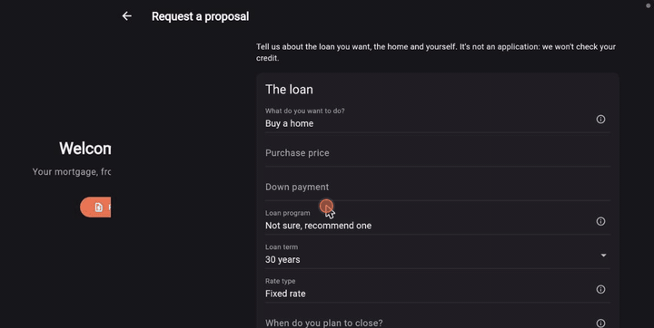

A home buyer fills in a proposal request, and a decision model checks
whether a lender can process it under current US rules: Fannie Mae's
eligibility matrix, the 2026 FHFA and FHA limits, FHA, VA and USDA rules,
and DTI limits. [README](MortgageHub/README.md)

### Contact Hub

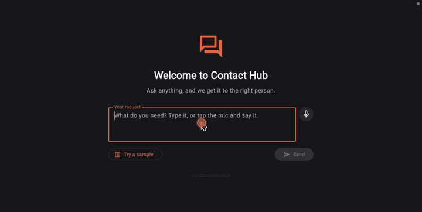

Ask anything and get routed to the right department or person. In one aityx
call, Jev classifies and checks the message, and a decision model picks the
department, the person and the priority. The app shows why, with the JSON
behind each item. [README](ContactHub/README.md)

### Health Plan

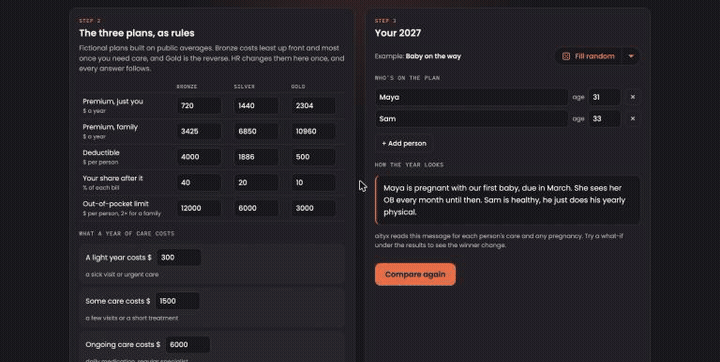

Which 2027 health plan will actually cost you less? Describe your family's
year in plain words. In one aityx call, Jev reads each person's care and any
pregnancy, and the plan rules price Bronze, Silver and Gold for that year.
A receipt per plan shows every number and where it came from, and what-if
switches show the winner change. [README](HealthPlan/README.md)
### Holiday Split

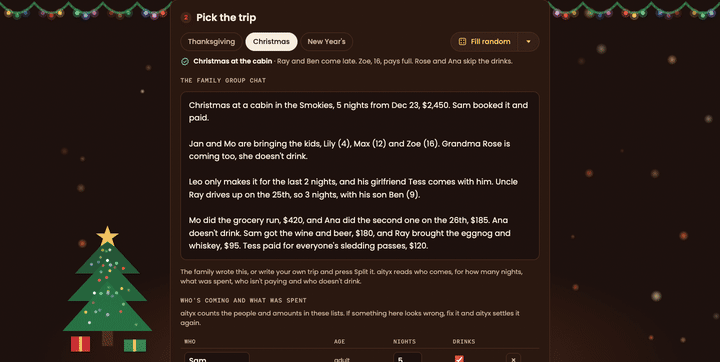

Who owes what after a holiday trip. Write the family's group chat, and
aityx reads who comes, for how many nights, what was spent, who isn't
paying and who doesn't drink; the house rules, a decision model on aityx,
say who pays whom, how much and by when, with a receipt for everyone.
From Thanksgiving at Mom's to New Year's at the lake with fifteen people. [README](HolidaySplit/README.md)

### Cellfie

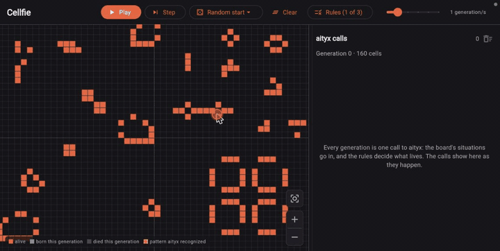

Conway's Game of Life on an infinite board, with the rules and the pattern
catalogue as a decision model. Each generation is one aityx call, which
labels the patterns it recognizes. Start from a soup, a glider fleet or a
methuselah, and switch between Conway, HighLife and Life without death.
[README](Cellfie/README.md)

### RiverRace

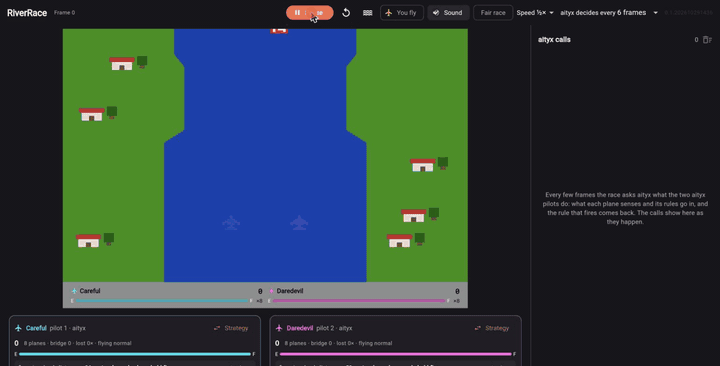

Three planes fly up the same river. aityx flies two of them, each with its
own table of rules that you can edit mid-flight, and you fly the yellow one
(arrow keys and space). The side panel shows every call and the rule that
fired. [README](RiverRace/README.md)

### RoboRules

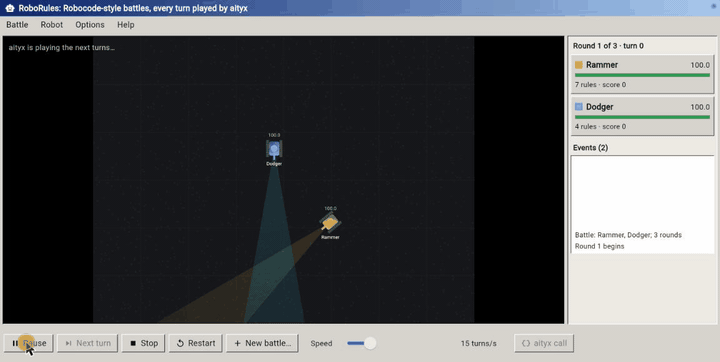

Tanks fight until one is left. Each robot's rules decide how it drives,
aims and fires, based on what it senses. aityx plays the battle itself, up
to 50 turns per call. Pick Robocode's sample robots or random ones, and edit
any robot's rules. [README](RoboRules/README.md)

### Outpost

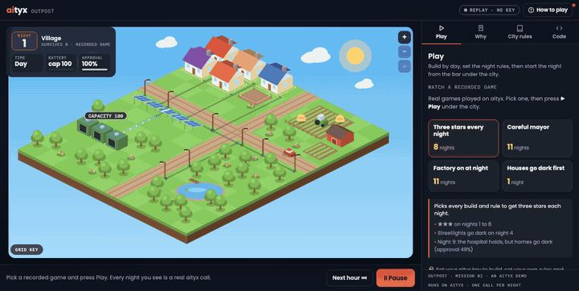

A city grows every night. By day you build a solar panel, a battery or a
wind turbine; before night you write the rules for what goes dark first.
Each night is one aityx call that runs it hour by hour, and the page draws
only what aityx answers, with a receipt that gives the rule behind every
number. How many nights can your city survive? [README](Outpost/README.md)

### PokerFace

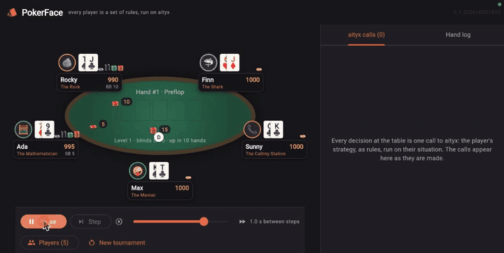

Every player at a table of up to nine is a decision model, called at each
turn with the player's cards, equity, pot odds and position. Five
strategies come with it (the Rock, the Maniac, the Calling Station, the
Mathematician and the Shark), or write your own. A sidebar shows every
call. [README](PokerFace/README.md)

## multyx

Multiplayer games on aityx: sign in with Google, bring a strategy written as
a decision model, and climb a leaderboard that the server plays. The
[index](multyx-index/) links them.

[](https://codespaces.new/aityx-labs/aityx-demos?devcontainer_path=.devcontainer%2Fmultyx%2Fdevcontainer.json&machine=standardLinux32gb)

| Demo | Address | What it shows |
|---|---|---|
| [Poker Tour](PokerTour/) | http://localhost:9810/pokertour/ | PokerFace for a team: enter a strategy in a tour played four times a day |
| [tatyx](tatyx/) | http://localhost:9710/tatyx/ | Three teams of bots race to hack the mainframe, every move an aityx decision |

Run them with `./start-multyx.sh` and open http://localhost:9700/.

### Poker Tour

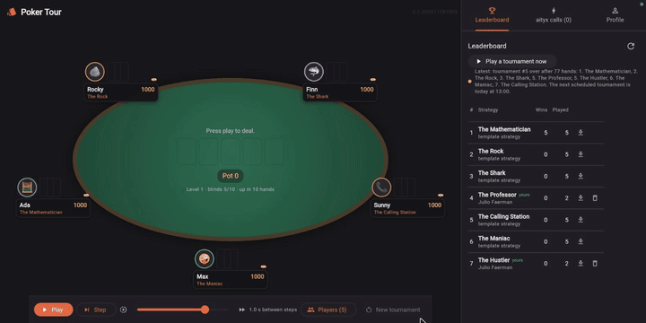

PokerFace's table for the people of aletyx (Google sign-in, `aletyx.com` and
`aletyx.ai`), on the host's aityx key. The app fetches that key from S3 with
the player's identity. Players enter their strategies in the tour, which
plays a tournament four times a day and whenever an admin asks. On AWS it is
serverless (`bash PokerTour/deploy/deploy.sh`). [README](PokerTour/README.md)

### tatyx

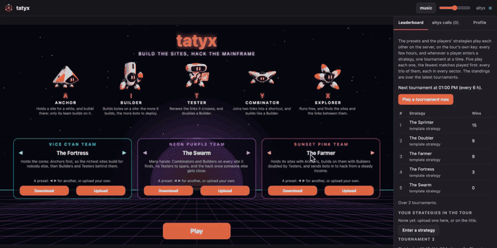

A Tron-style game with a synthwave soundtrack. Three teams race to hack the
mainframe, building bytes on the map's sites with five kinds of bots. Nobody
plays by hand: each team's strategy is a decision model (a preset or your
own upload), and every megabyte is one aityx call, shown beside the map.
Built with Phaser 4 and TypeScript. [README](tatyx/README.md)

## datyx

A data system in the making: an API, its dashboard, and HealthHub. The data
lives in PostgreSQL, is catalogued in [OpenMetadata](https://open-metadata.org),
and streams through Kafka and Flink, all as containers, so the group needs
[Docker](https://docs.docker.com/get-docker/). The [index](datyx-index/)
links them.

[](https://codespaces.new/aityx-labs/aityx-demos?devcontainer_path=.devcontainer%2Fdatyx%2Fdevcontainer.json&machine=standardLinux32gb)

| Demo | Address | What it shows |
|---|---|---|
| [datyx dashboard](datyx-dashboard/) | http://localhost:9906/app/ | The catalogue, the models datyx trains, and their inference |
| [datyx API](datyx/) | http://localhost:9900/q/swagger-ui | Data sources, a catalogue, and forecasting models trained on them |
| [HealthHub](HealthHub/) | http://localhost:9801/app/ | Patients triaged by aityx from what they say at a hospital's front desk |

Run them with `./start-datyx.sh` and open http://localhost:9800/. A first
start takes a few minutes.

### datyx dashboard

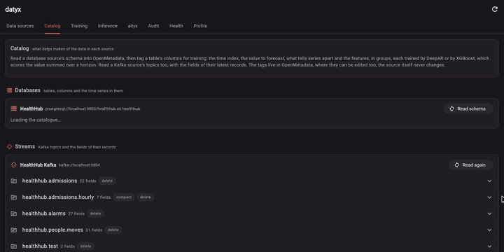

The views of datyx, with every API call in a side panel: data sources, the
catalogue and its tags for DeepAR and XGBoost, training runs and their
results, inference, an audit of every request, and the health of each
service. It only displays data: the logic lives in the API.
[README](datyx-dashboard/README.md)

### datyx API

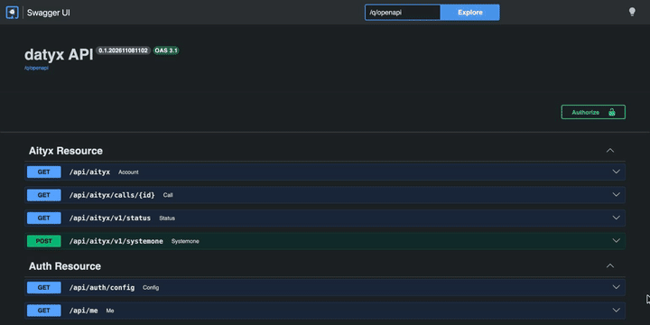

A Quarkus API on GraalVM over PostgreSQL. It stores each user's data sources
with their access details encrypted, and registers their tables in
OpenMetadata. It trains the tables tagged there for DeepAR or XGBoost on a
schedule, then scores series on demand. [README](datyx/README.md)

### HealthHub

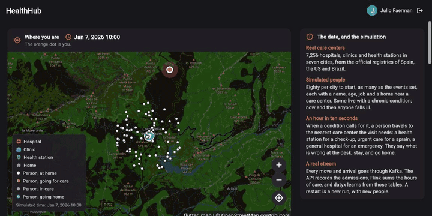

A Flutter app and a Dart API. A simulation of people moving across the map
streams through Kafka. aityx triages every patient from what they say at the
desk: how soon they must be seen, where they go, and why. A Flink job counts
admissions per hospital and hour, the series datyx forecasts.
[README](HealthHub/README.md)

## Running locally

With [Devbox](https://www.jetify.com/devbox), from the repository root:

```bash
./start-aityx.sh             # the aityx group (or name demos: ./start-aityx.sh ContactHub)
./start-multyx.sh            # the multyx group
./start-datyx.sh             # the datyx group
./start-all.sh               # all three
./stop-all.sh                # or ./stop-aityx.sh, ./stop-multyx.sh, ./stop-datyx.sh
./restart-all.sh             # fast-forward git, then restart every demo
```

A start builds any demo whose build is older than its sources (a minute or
two), then prints each link once it answers. [build-all.sh](build-all.sh)
builds them ahead of time.

### A dev key

If you haven't set a key in the browser, the apps fall back to the server's
`AITYX_API_KEY`, from its environment or the root `.env` (copy
[.env.example](.env.example)). The server proxies the calls, so the key
never reaches the browser.

Local development runs on aityx staging: the `.env` key is a staging key,
with `AITYX_URL=https://api-stage.aityx.ai`. Published demos carry no key
and call production (`https://api.aityx.ai`) with each visitor's key.
Deploys read only `AITYX_PROD_URL` and `AITYX_PROD_API_KEY`. The same `.env`
key runs each demo's `scripts/model-test.sh`.

Nothing that git ignores goes into a Docker image. Run
[sync-dockerignore.sh](sync-dockerignore.sh) after changing a `.gitignore`
or adding a Dockerfile.

## Codespaces

Each group's badge opens its own dev container on a 4-core machine (16 GB),
which starts the group and opens its index. The web ports are made public,
so you can share the links, and each visitor sets their own key. If a port
shows Private, switch it to **Public** in the **Ports** panel.

Optionally, add an `AITYX_API_KEY`
[Codespaces secret](https://github.com/settings/codespaces) with access to
this repository. The servers lend it to visitors who haven't set a key. It
is never written to disk, logged or sent to a browser. An `AITYX_URL`
secret sets the endpoint (`https://api.aityx.ai` by default).

Each dev container uses a published image with the toolchain and the
demos' release builds, so a codespace starts in seconds. Only demos changed
since the image was built get rebuilt. GitHub prebuilds and Actions are off
for this organization, so the images are built on a laptop and pushed
after merging to `main` (`bash image/build-image.sh aityx|multyx|datyx`, see
[image/](image/)). Startup logs go to `startup.log` at the root.

## License

[MIT](LICENSE).
